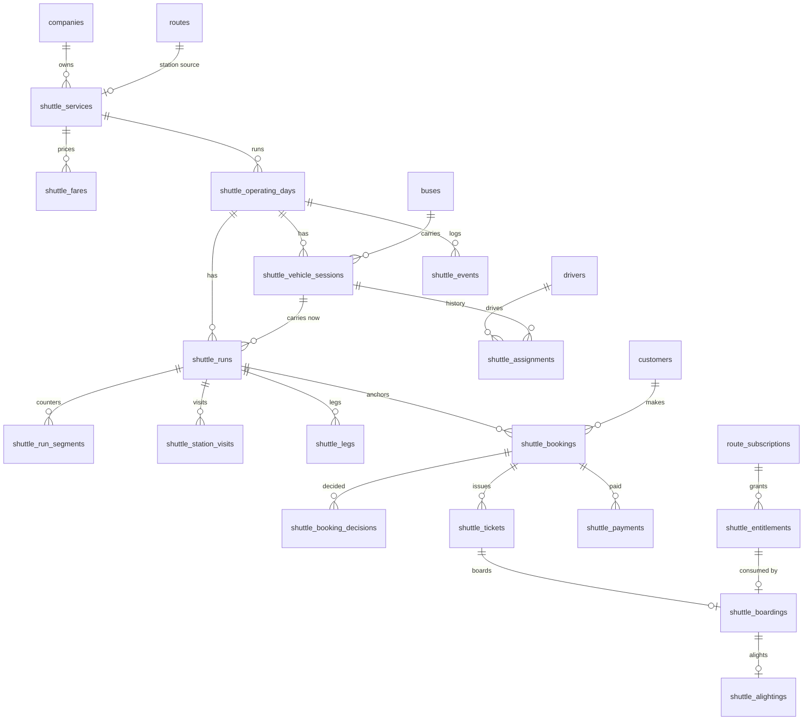

# MASAR: Continuous Shuttle Operations — implementation plan

Repo `pagecraftstudio/GUber`, `main` at `58303be` (merge of PR #79). Latest migration `0073_analytics_site_page_view.sql`, so next free number is **`0074`**.
Read-only audit. No code, migration, branch or config was changed. Suggested repo path: `docs/plans/CONTINUOUS-SHUTTLE-PLAN.md`.

Legend: **[V]** verified in repo · **[M]** exists, needs modification · **[N]** does not exist · **[P]** proposed · **[?]** unverified assumption.

---

## 1. Executive summary

- Continuous shuttle = bus loops through ordered stations all day. Legs are created at departure, not pre-scheduled. Seats are sold per segment.
- **Do not reuse `trips`, `bookings`, `tickets`.** They hard-require a pre-known `departure_at/arrival_at`, a single `seats_booked` counter, a scheduled-trip state machine, bus/driver overlap exclusion constraints, and `trip_id NOT NULL` on bookings and tickets. Bending them risks every existing company. **Build a parallel `shuttle_*` domain**, reuse the *infrastructure and patterns* (RLS helpers, tenant guard, jobs, notifications, token hashing, captcha, analytics, audit).
- Correctness core = one row lock per **run** (a one-direction pass of a bus), plus per-segment counter rows with a CHECK, written in the same transaction as every confirm / cancel / move. This copies the proven invariant style of `0010` (`trips.seats_booked`, `trips_seats_valid`, `seat_drift()`).
- **Critical finding:** existing student subscriptions (`route_subscriptions`, `0034`) mean "valid for a period, one go + one return **per day**" (`route_subscription_scans` unique `(subscription_id, service_date, direction)`). The new requirement is "**one outbound + one return in total**". These are different models. New entitlement tables are required; the old scan path must not touch shuttle plans.
- Online requests are *requests*, hold no seat, and are confirmed by driver or manager through a locked RPC. First lock wins.
- Offline: boarding, confirm and capacity decisions stay **online-only**. Existing ticket tokens are stored hash-only and rotate on every `my_ticket_qr()` call, so offline QR verification is impossible by design. Controlled fallback in §14.
- 10 phases (S0–S9), about 6 migrations (`0074`–`0079`), roughly 12 RPC groups. Complexity High overall, mostly in S3/S4/S7.

---

## 2. Understanding of the business model

One company, one shuttle service (e.g. Galala University ↔ Suez ↔ Porto Sokhna), N vehicles. Each vehicle repeats: arrive → alight → load → depart → …; at the last station it reverses (if configured). Passengers: online requests (need confirmation), walk-ins, subscribers (1 outbound + 1 return entitlement, consumed on boarding). Cash is collected at the destination. Manager can swap driver/vehicle mid-day; history must stay truthful.

Three concepts kept separate (as briefed): **Operating Day**, **Vehicle assignment**, **Trip Leg**. I add two more that the design needs: **Run** (one-direction pass; the thing bookings attach to) and **Station Visit** (arrive → load → depart at one station; this *is* the "loading session").

---

## 3. Existing repository audit

### 3.1 Verified facts [V]

| Area | Finding | Where |
|---|---|---|
| Migrations | 74 files, latest `0073`. Tests: `supabase/tests/` (72 files incl. `lock-oracle.sh`, `publish-race.sh`), integration `tests/integration/*.int.test.ts`, e2e `tests/e2e/*.mjs`, runner `tests/run-all-local.sh` (local PG16 + PostgREST) | repo |
| Tenancy | Every tenant table: `company_id` FK + `unique(company_id,id)` + composite FKs, triggers `000_tenant_guard`, `forbid_company_id_change`, `set_updated_at`; append-only via `forbid_modify` | `0003`, `0014`, `0034` |
| Authz helpers | `app_private.has_permission(company,key)`, `is_company_active`, `is_my_driver`, `driver_route_ok`, `driver_bus_ok`; acting-as for platform users through `acting_allows` (read mode = `*.read` keys only) | `0006`, `0065`, `0066` |
| Permission keys | `bookings.*, buses.*, drivers.*, routes.*, trips.read/write/read_assigned, settings.*, users.*, website.*, media.*, domains.*, analytics.read, audit.read, billing.read, notifications.*, customers.*` ; roles seeded as data (`roles`, `role_permissions`) | `0005` |
| Trips | `trips` has `status in (draft,scheduled,boarding,in_progress,completed,cancelled)`, `arrival_at` NOT NULL, `capacity`, `seats_booked` + CHECK `trips_seats_valid`, GiST exclusions `trips_bus_no_overlap` / `trips_driver_no_overlap` on `(bus/driver, tstzrange(departure_at, blocked_until))`, `ended_at` added in `0060` | `0003`, `0027`, `0060` |
| Bookings | `bookings.trip_id NOT NULL`, pickup/dropoff stop FKs, `seats_count`, `status in (pending,confirmed,cancelled,completed,no_show)`, `payment_status`, `subscription_id`, `amount_paid` (`0032`). Seat counter maintained by trigger; `seat_drift()` reconciler. Writes via `create_booking`, `create_my_booking`, `cancel_booking`, `set_booking_status`, `set_booking_amount_paid`, `set_booking_payment_status`. Locks: trip then booking `FOR UPDATE` | `0010`, `0032` |
| Tickets | `tickets` (`trip_id NOT NULL`, `token_hash bytea` unique, `status valid/boarded/void`, `ticket_index`), `boarding_events` (append-only, `unique(ticket_id)`). RPCs `board_ticket`, `confirm_boarding`, `driver_trip_boarding`, `my_ticket_qr` (issues a **fresh token each call, invalidating older**), `my_tickets`. No client table grants | `0014`, `0020` |
| Subscriptions | `route_plans`, `route_subscriptions` (`pending/active/rejected/cancelled/expired`, `valid_from/to`, `paid_at`), `route_subscription_scans` (one go + one return per day), RPCs `request_route_subscription`, `decide_route_subscription`, `create_my_subscriber_booking`, expiry job `0038`, notices `0041` | `0034`–`0041`, `0055` |
| Identity QR | `profiles.masar_id`, `my_masar_qr()` (rotating signed token), `scan_identity(code, trip)` returns driver card | `0052` |
| Notifications | `notifications` (dedupe unique `(dedupe_key, channel)`), `notification_events` catalogue (`is_live` flag), `notification_preferences`, `app_private.enqueue_notification(...)`, inbox RPCs `my_inbox`, `my_unread_count` | `0053`, `0056` |
| Scheduler | `app_private.jobs` + `app_private.run_due_jobs()` (advisory lock, `skip locked`, heartbeat, failure notice `platform.job_failed`) | `0053` |
| Other infra | `rate_limit_hit` buckets (`0020`), captcha passes (`0057`, `0062`), analytics (`0068`–`0073`), plan entitlements + `enforce_limit` trigger, `admin_create_entitlement_definition` (`0064`) | listed |
| Driver app | `src/app/driver/{page.tsx,boarding,inbox,profile,trips/[id]}`, `public/driver-sw.js`, `public/driver.webmanifest`, offline manifest cache (`manifest-cache.ts`). SW **never** caches HTML/RSC/Supabase and never answers scan/board/end-trip from cache. Boarding online-only | `0060`, repo |
| Dashboard | `src/app/dashboard/{bookings,buses,customers,drivers,plans,routes,settings,subscriptions,trips,users,website}` | repo |
| Service layer | `src/lib/service/{authorize.ts,context.ts,server.ts}` | repo |
| Realtime | **No** `supabase.channel` / `.channel(` usage found in `src` | grep |

### 3.2 Gaps [N]

No operating-day / run / leg / station-visit model; no segment capacity; no pending-request-with-confirmer flow; no per-direction entitlement; no fare-per-station-pair; no payment ledger (the `booking_payments` table exists but is "unused by V1"; `amount_paid` is a single mutable number set by staff); no driver replacement history inside a day; no Realtime.

### 3.3 Not verified [?] (verify in S0 before S1)

- Bodies of `scan_identity`, `board_ticket` (only signatures + headers read). Token format helper name `app_private.ticket_token_hash`.
- Customer identity RPCs (`claim_my_customer`, `create_my_booking`) internals; marketplace page paths under `src/app/(marketplace)`.
- Whether push/email delivery workers exist (notification slice c). Plan assumes **in-app only** until verified.
- Exact next SQL test suite number (take next after the highest in `supabase/tests/`).
- Whether `routes`/`route_stops` edits are guarded while in use (mitigated by snapshotting stations, §6).

---

## 4. Reuse vs new

| Capability | Decision | Reason |
|---|---|---|
| `buses`, `drivers`, `customers`, `profiles`, `companies`, `company_users`, roles | **Reuse** unchanged | Same physical resources and identities |
| `routes` + `route_stops` | **Reuse as station source**, snapshot per day | `stop_order` already exists. Snapshot protects running days from edits |
| `trips`, `bookings`, `tickets`, `boarding_events` | **Do not reuse** | See §1. Keeps scheduled mode untouched (rule 12/13) |
| Ticket token hashing + "fresh token per display" pattern | **Reuse helper, new table** `shuttle_tickets` | Same security properties, no `trip_id` coupling |
| `route_plans`/`route_subscriptions` (purchase, approval, validity, expiry, renewal) | **Reuse as purchase record** [P, owner decision S-D1] | Avoid duplicating the plan/approval UI. Add only entitlement tables. One additive column `route_plans.model text not null default 'daily_pair'` (`'shuttle_pair'`); existing RPCs must reject `shuttle_pair` |
| Notifications, jobs, captcha, rate limit, analytics, audit | **Reuse** | Add catalogue rows / job rows / event keys |
| Payment ledger | **New** `shuttle_payments` | Append-only, idempotent; `amount_paid` single-number model is too weak |

Fallback for S-D1 if owner refuses touching `route_plans`: new `shuttle_plans` + `shuttle_subscriptions` (more duplication, zero change to existing tables).

---

## 5. Product rules (fixed by owner, restated)

1. Stations visited in order, no skipping in normal ops. 2. Next leg created only at departure after loading closed. 3. Online booking = request, no seat guarantee. 4. Driver or manager may confirm/reject. 5. First atomic confirm wins. 6. Subscription = 1 outbound + 1 return, no pre-reservation. 7. Entitlement consumed at boarding only. 8. Vehicle swap moves all onboard passengers + affected confirmed bookings, capacity-checked. 9. Driver swap allowed. 10. Past legs keep original vehicle/driver. 11. Capacity per segment. 12. Separate from scheduled mode. 13. No regressions. 14. Cash at destination, no gateway. 15. Unreliable connectivity assumed.

---

## 6. Domain model [P]

All tables: `company_id` + `unique(company_id,id)` + composite FKs + `000_tenant_guard` + `forbid_company_id_change` + `set_updated_at`; RLS on; `revoke all` from `anon, authenticated`; reads by RPC or staff `select` policy gated by `has_permission(company,'shuttle.read')` and `is_company_active`; platform read via the existing `platform_select` pattern. **No client writes anywhere.**

| Table | Purpose | Key columns / constraints | Lifecycle |
|---|---|---|---|
| `shuttle_services` | Company config for one shuttle route | `route_id`→routes, `name`, `hub_station_idx`, `allow_reverse bool`, `request_ttl_minutes`, `outbound_direction` (`forward`/`backward`), `allow_walk_in`, `is_active`. Partial UQ one live service per route | Config, soft-disable |
| `shuttle_fares` | Price per station pair | `(service_id, from_idx, to_idx, price)`, `from_idx<>to_idx`, UQ | Config. Snapshot into booking |
| `shuttle_operating_days` | The day | `service_id`, `service_date` (anchor date in company TZ, **not** derived from timestamps), `status open/closed/reconciled`, `tz` snapshot, `stations jsonb` **snapshot** (idx, name, stop_id), `opened_by`, `closed_at`, `reconciled_by`. UQ `(service_id, service_date)` where status<>'cancelled' (blocks double start) | open → closed → reconciled |
| `shuttle_vehicle_sessions` | One physical vehicle in a day | `day_id`, `vehicle_id`, `state` (§7), `current_driver_id`, `current_run_id`, `capacity` snapshot, `replaced_by_session_id`. Partial UQ `(vehicle_id) where state<>'completed'` and same for `current_driver_id` (no two live sessions per bus/driver across days/companies of same tenant) | ready … completed |
| `shuttle_assignments` | Vehicle/driver history | `session_id`, `vehicle_id`, `driver_id`, `effective_from`, `effective_to`, `reason`, `authorized_by`. **Append-only** + GiST exclusion `(driver_id with =, tstzrange(effective_from, coalesce(effective_to,'infinity')) with &&)` (btree_gist already used) | Never updated except closing `effective_to` via function |
| `shuttle_runs` | One direction pass; **booking anchor** | `day_id`, `run_no`, `direction`, `session_id` (current carrier, changes on vehicle swap), `status planned/active/finished/aborted`. UQ `(day_id, run_no)`. **The row locked for every capacity decision** | created at day start and at reversal |
| `shuttle_run_segments` | Per-segment counters | `(run_id, seg_idx, capacity, confirmed_seats)`, `CHECK confirmed_seats between 0 and capacity`. One row per consecutive station pair | maintained in same tx as confirm/cancel/move/replace |
| `shuttle_station_visits` | Loading session | `session_id`, `run_id`, `station_idx`, `arrived_at`, `loading_started_at`, `loading_closed_at`, `departed_at`, `arrival_recorded_by`, `late_recorded bool`. UQ `(session_id, run_id, station_idx)` | at arrival |
| `shuttle_legs` | **Trip Leg**, created at departure | `run_id`, `session_id`, `seq`, `from_station_idx`, `to_station_idx` (= from±1 by direction, CHECK), **`vehicle_id` + `driver_id` snapshots**, `departed_at`, `arrived_at`, `status in_transit/arrived/interrupted`, `continuation_of_leg_id`, `onboard_at_departure`. UQ `(session_id, seq)`, partial UQ one `in_transit` leg per session. Immutable snapshot columns | in_transit → arrived (or interrupted) |
| `shuttle_bookings` | Request + confirmed journey | `reference`, `run_id`, `customer_id`, `user_id` null, `from_idx`, `to_idx` (CHECK per run direction), `seats`, `unit_price` + `total_due` snapshots, `source online/walk_in/staff`, `status requested/confirmed/rejected/expired/cancelled/no_show/boarded/alighted`, `payment_mode cash/subscription`, `expires_at`, `idempotency_key` (UQ per company), `decided_by`, `decided_role`, `decided_at`, `vehicle_session_id` at decision | see §9 |
| `shuttle_booking_decisions` | Append-only decisions | `booking_id`, `decision confirm/reject`, `actor_id`, `actor_role`, `at`, `day_id`, `session_id`, `from_idx`, `to_idx`, `seats`, `outcome ok/already_processed/no_capacity` | log every attempt incl. losers |
| `shuttle_tickets` | One per seat after confirm | like `tickets`: `booking_id`, `ticket_index`, `token_hash` UQ, `status valid/boarded/void` | issued on confirm |
| `shuttle_boardings` | Append-only boarding proof | `unique(ticket_id)` (idempotency by construction), `visit_id`, `leg_id` (the leg it boarded onto), `session_id`, `driver_id`, `via ticket/masar/walk_in/manual`, `client_occurred_at`, `recorded_at` | immutable |
| `shuttle_alightings` | Append-only | `boarding_id` unique, `visit_id`, `at`, `recorded_by`, `kind normal/manual_close/auto_close` | immutable |
| `shuttle_entitlements` | Student rides | `subscription_id`→route_subscriptions, `direction outbound/return`, `status available/consumed/void`, `consumed_by_boarding_id` **UQ**, UQ `(subscription_id,direction)` | 2 rows created at subscription approval |
| `shuttle_entitlement_events` | Append-only | `consumed/void/restored`, reason, actor | audit of balance |
| `shuttle_payments` | Cash ledger | `booking_id`, `kind collect/void`, `amount>0`, `method`, `collected_by`, `collected_role`, `collected_at`, `receipt_no`, `idempotency_key` UQ `(company, booking, key)`, `voids_payment_id`, `void_reason`. **Append-only** | immutable |
| `shuttle_events` | Operational log | `day_id`, `session_id`, `kind`, `actor_id`, `actor_role`, `payload jsonb`, `client_occurred_at`, `recorded_at`, `idempotency_key` UQ per session. Append-only | feeds history screen + analytics |

Derived (views/RPC, not stored): occupancy per segment, balance due per booking, manifest per visit, utilisation. Reconciler `shuttle_segment_drift()` (like `seat_drift()`).

### ER diagram



### Answer to "bookings across segments"
A booking stores `from_idx`/`to_idx` on a run. It occupies segments `from_idx … to_idx-1` of that run (direction-normalised so `seg_idx` always runs 0..n-2 in travel order of that run).

---

## 7. Vehicle state machine

States: `ready`, `loading`, `in_transit`, `arrived`, `completed`, `out_of_service`. ("Loading closed" is a timestamp on the visit, not a state.)

| From | Action (RPC) | To | Who | Records / transaction |
|---|---|---|---|---|
| (none) | `shuttle_start_day` | `ready` | manager | day, sessions, runs, segments, assignments, event. One tx |
| `ready` | `shuttle_open_loading` | `loading` | assigned driver, manager | visit row at start station |
| `loading` | `shuttle_close_loading` | `loading` (closed flag) | driver, manager | `loading_closed_at`. Further walk-ins/confirms for this visit refused |
| `loading` | `shuttle_depart` | `in_transit` | driver, manager | Locks session. Requires visit exists. Closes loading if open. Creates **next leg** with vehicle/driver snapshots. Expires remaining `requested` bookings that board here. Marks un-boarded confirmed bookings at this station `no_show`, **releases their later segments** (policy S-D6). One tx |
| `in_transit` | `shuttle_arrive` | `arrived` | driver; manager override with `late` + reason | Sets leg `arrived`, creates visit at next station. Auto-alights passengers whose `to_idx` = this station as **due** (not alighted until confirmed, see below) |
| `arrived` | `shuttle_alight` (per passenger / bulk) | `arrived` | driver, manager | `shuttle_alightings`, booking→`alighted`, payment becomes due |
| `arrived` | `shuttle_open_loading` | `loading` | driver, manager | Requires all passengers with `to_idx` here alighted or explicitly kept (manager reason). If last station: reverses (new run, direction flipped, segments built) when `allow_reverse`, else → `completed` |
| `ready/loading/arrived` | `shuttle_end_session` | `completed` | manager (driver if onboard=0) | Needs onboard=0 |
| `ready/loading/arrived` | `shuttle_set_out_of_service` | `out_of_service` | manager; driver may *report* (creates request) | Reason required |
| `in_transit` | `shuttle_emergency_halt` | `out_of_service` | **manager only** | Leg → `interrupted`. Exceptional flow, §12 |
| `out_of_service` | `shuttle_return_to_service` | `ready`/`arrived` (where it was) | manager | |

Idempotency (double press): every action takes `p_expected_state`, `p_visit_or_leg_seq`, and `p_idempotency_key`. Same key → returns the stored result (`replayed:true`). Different key but state already moved → error `stale_state` with current state, **no second leg, no second visit** (unique indexes make it impossible anyway). Driver forgets arrival: leg stays `in_transit`; job alerts after `expected_minutes × 2`; manager/driver may record arrival with `occurred_at` (≤ now, ≥ departed_at) → `late_recorded=true`.

---

## 8. Booking lifecycle

`requested → confirmed → boarded → alighted`
`requested → rejected | expired | cancelled`
`confirmed → cancelled | no_show`
`boarded → alighted` (cancel after boarding **not allowed**; manager correction `void_boarding` with reason restores entitlement through an `entitlement_event`).

- Request creation `shuttle_request_booking(run, from, to, seats, key)` (customer; captcha pass + `rate_limit_hit`). Validates: run active/planned, `from_idx` not yet passed (vehicle hasn't departed that station), `to` after `from` in run direction, seats ≤ `max_seats`, service active, company active. **Does not hold capacity.** `expires_at = least(now()+ttl, departure from boarding station)`.
- UI shows only: *Request submitted – awaiting driver/manager confirmation. Not a confirmed seat.*
- Customer may show "seats left (approx.)" from counters, labelled approximate.

### Confirm (first wins)
```
shuttle_decide_booking(p_booking, p_decision, p_key)
 1. authenticate; derive company from booking (never from client)
 2. SELECT run FOR UPDATE            -- serialises ALL decisions on this run
 3. SELECT booking FOR UPDATE        -- lock order run → booking (same discipline as 0010: trip → booking)
 4. if booking.status <> 'requested' → log decision outcome='already_processed'; return {already_processed, by, at, decision}
 5. check actor: manager (shuttle.confirm) OR driver of run's CURRENT session (is_my_shuttle_driver)
 6. check not expired, boarding station not departed, day open, session state in (ready,loading,arrived-before-station...)
 7. confirm: for each seg in [from,to): confirmed_seats += seats  → CHECK (≤ capacity) fails ⇒ outcome='no_capacity', status stays requested (manager can reject/move)
 8. insert shuttle_booking_decisions, issue tickets (token hashes), enqueue notification, write shuttle_events — same tx
```
Reject: same lock path, no counters touched. Cancel releases segments in same lock path. Cancel-vs-confirm race: both take the run lock; the later one sees the earlier result.

Walk-in: `shuttle_add_walk_in` (driver/manager, only for the **current loading visit**, `from_idx` = current station). Same capacity function, status `confirmed` + ticket + (optional) immediate board.

---

## 9. Segment capacity algorithm

Run has stations `0..n-1` in travel order, segments `0..n-2`. Booking `[from,to)`.
`available(seg) = capacity − confirmed_seats(seg)`; request feasible iff `max over seg∈[from,to) of confirmed_seats + seats ≤ capacity`.

Worked example (28 seats; A: 0→1 ×10, B: 0→2 ×8, C: 1→2 ×5): seg0 = 18 (10 free), seg1 = 8+5 = 13 (15 free). Matches the brief.

- Counters count **confirmed** bookings (including boarded). Pending/rejected/expired never count.
- Boarding does not change counters (seat already reserved). Alighting does not change counters (segments behind the bus are irrelevant).
- No-show at departure: release segments `≥ from` of that booking (seat reusable downstream). Cancel: release all its segments.
- Vehicle swap: recompute `capacity` on all remaining segments; block if any `confirmed_seats > new capacity` (§12).
- Source of truth = DB. Client shows numbers but never decides. `shuttle_segment_drift()` + SQL test recompute from bookings and compare.

---

## 10. Trip Leg lifecycle

`created at shuttle_depart` → `in_transit` → `arrived` (or `interrupted`). Next leg only after the visit's loading is closed and depart called. Legs never mutated except `arrived_at/status`; vehicle/driver columns are immutable snapshots (trigger `forbid_update_of` those columns). Direction reversal: at last station, `open_loading` creates run `n+1` (opposite direction, fresh segment rows, capacity of the current vehicle). Bookings never carry over between runs.

---

## 11. Subscriptions and entitlements

- Purchase/approval/expiry reuse `route_plans/route_subscriptions` with `model='shuttle_pair'` (S-D1). On approve, trigger/RPC inserts two `shuttle_entitlements` rows (`outbound`, `return`).
- Which entitlement a ride consumes = the **run direction** relative to `shuttle_services.outbound_direction`. (Owner decision S-D2: confirm that "outbound" = campus → away, "return" = towards campus, regardless of how many stations.)
- Request/confirm check *availability only* (`exists available entitlement`), never reserve. Displayed to the student as balance.
- Consume inside `shuttle_board_ticket` / `shuttle_board_masar`: `select … from shuttle_entitlements where subscription_id=… and direction=… and status='available' for update skip locked limit 1`; update to `consumed`, `consumed_by_boarding_id = new boarding id` (**UNIQUE**) — same tx as inserting the boarding. Repeated scan hits `unique(ticket_id)`, returns `already_boarded`, consumes nothing. Concurrent scans on two buses: row lock; loser gets `no_entitlement`.
- No entitlement at boarding (used elsewhere, or expired): driver card shows it; default policy = **block, manager may authorise cash fare** with audit (S-D11).
- Validity: checked against the **operating day's `service_date`**, not `now()` (handles after-midnight days). Expiry job voids unused entitlements (`void`, event logged), pattern from `0038`.
- Existing daily-pair scan path (`scan_route_subscription`, `create_my_subscriber_booking`) must reject shuttle-model plans (test).

---

## 12. Payments

`shuttle_payments` append-only ledger. `total_due` snapshot from `shuttle_fares` at confirm (0 if `payment_mode='subscription'`). Balance = due − sum(collect) + sum(void). Due state starts when passenger is alighted (S-D10 default). RPC `shuttle_collect_payment(booking, amount, method, key)`: locks booking, rejects subscription-mode, rejects over-collection (manager override logged), unique idempotency key → duplicate returns original row. Wrong booking / double entry: **void by manager** (reversal row + reason), never edit/delete. Unpaid-completed list = alighted, balance>0. Day reconciliation compares collected per driver vs manager-declared cash handed in. Risk of mutable `payment_status` without ledger: silent edits, no collector identity, impossible to reconcile. That is why `amount_paid` style is not reused.

---

## 13. Vehicle / driver replacement

**Driver swap** `shuttle_replace_driver(session, new_driver, reason)` (manager): lock session; new driver active, not in another live session, no overlap with scheduled `trips` window (check function, see risk R5); close current assignment (`effective_to=now`), insert new; `current_driver_id` updated; bookings untouched; past legs keep their snapshot; notify new driver.

**Vehicle swap at a station** `shuttle_replace_vehicle(session, new_bus, reason)` (manager; allowed when state ∈ `loading, arrived, ready`):
1. Lock old session, run, all its segment rows, then new session.
2. New bus active, not in another live session, compatible service.
3. For every remaining segment (current station onward): `confirmed_seats ≤ new_capacity`. Else **abort with list of overloaded segments + bookings**; manager must `shuttle_move_booking` / reject specific bookings, then retry. No silent partial transfer.
4. Onboard passengers: they are already counted in segments from the current station; check passes ⇒ they move operationally.
5. Old session → `completed` (`replaced_by`), new session `loading` at same station with same run; `shuttle_runs.session_id` = new; segment `capacity` rewritten; assignment rows; tickets stay valid (bound to **run**, not vehicle).
6. Events + audit with old/new vehicle, driver, station, affected booking ids, reason. Notify affected customers.

**In transit:** normal replacement **blocked**. Exceptional `shuttle_emergency_halt` (manager only, reason, owner-approved workflow, S-D9): leg → `interrupted`, session `out_of_service`; replacement bus is dispatched and attached through `shuttle_replace_vehicle` with `at_station=null`; resumes with a **new leg** `continuation_of_leg_id` = interrupted leg, new vehicle snapshot. Capacity check identical. Marked in analytics as emergency.

---

## 14. Offline / unreliable connectivity

Facts: SW never answers boarding/scan from cache; offline manifest cache is read-only, 12 h, per user. Tickets are hash-only and rotate per display, so a device **cannot** verify a QR offline. Do not change that.

| Action | Offline | Rule |
|---|---|---|
| View manifest, route, stations | Yes (cached read-only) | Label "last synced hh:mm" |
| Confirm/reject, board, collect cash, replace | **No** (queue disabled) | Capacity and entitlement are server decisions |
| Arrive / depart | **Queue as intent** with `client_occurred_at`, idempotency key, device sequence | Server accepts in order, `late_recorded=true`, rejects if state moved (`stale_state`) |
| Cash received | Local note "pending sync" with key | Server validates (booking exists, balance, not subscription) on sync; idempotent |
| Scan fails (no net) | Driver lets passenger board visually (manifest shows confirmed) and marks "board when online" | Entitlement consumed only on server-validated sync; if rejected → manager review list |

Fallback summary: manifest-based visual boarding + deferred server validation. Never green state without the server.

---

## 15. Dashboard (company manager) [P]

Routes under `src/app/dashboard/shuttle/`:

| Screen | Content |
|---|---|
| Overview `/shuttle` | Today's day, per-vehicle card: station, direction, state, driver, onboard/capacity, pending requests, next-segment free seats |
| Start day `/shuttle/start` | Service, vehicles, drivers, start station/direction per vehicle, conflict warnings, confirm |
| Vehicle `/shuttle/vehicles/[id]` | Current/next station, leg, loading progress, history, actions (depart, arrive override, out of service, replace) |
| Requests `/shuttle/requests` | Table, capacity impact preview per row, confirm/reject, `already processed by X at hh:mm` on race |
| Assignments `/shuttle/assignments` | Replace driver/vehicle, history, conflicts |
| Manifest `/shuttle/manifest` | By station: boarding/onboard/alighting/alighted, ticket + payment state |
| Collection `/shuttle/cash` | Due, collected, unpaid completed, subscription-covered, void action |
| History `/shuttle/history` | `shuttle_events` timeline |
| Config `/shuttle/settings` | Service, stations (from route), fares matrix, TTL, reverse, walk-in |

Polling 10 s on overview/requests (no Realtime in repo; see §21).

## 16. Driver app [P]

`src/app/driver/shuttle/` (reuse `/driver` layout, SW, manifest). One mobile screen, state-driven:
- **Loading:** pending requests (confirm/reject), scan ticket, scan MASAR QR (walk-up subscriber → one-tap board), walk-in add, onboard/expected alight list, free seats on upcoming segments, **Close loading**, **Depart**.
- **In transit:** next station, who alights, route progress, **Arrived**.
- **Arrived:** alight list (tap each / bulk), collect cash per passenger, **Start loading** (or reverse).
- Permission: driver sees only his current session's run, passenger name + seats + from/to + payment due; no phone, no company settings, no other sessions.
- Arabic default / RTL, large buttons, double-tap guarded by idempotency keys. Reuse `driver-sw.js` rules (bump `VERSION`).

## 17. Customer experience [P]

Marketplace: pick service → boarding + destination → shows eligible vehicles/runs with approximate free seats and states `Available / Request submitted / Awaiting confirmation / Confirmed / Full / No longer accepting` → submit (captcha) → status page with "not confirmed yet" banner → on confirm ticket QR via `shuttle_my_ticket_qr` (fresh token per display) → shows payment due / subscription balance (`1 outbound, 1 return`). Notifications in inbox: submitted, confirmed, rejected, expired, vehicle changed, payment due/recorded, journey completed. **Route QR inside the bus** = discovery only (opens booking page for that service/vehicle session with a public slug). Never proof of boarding. Self-check-in via route QR is **not recommended for V1**; it would need rotating token, geofence or driver co-sign, and rate limits.

---

## 18. Permissions matrix [P]

New keys (seed pattern `0005`): `shuttle.read`, `shuttle.operate` (day, sessions, depart/arrive override), `shuttle.confirm`, `shuttle.assign`, `shuttle.cash`, `shuttle.config`, `shuttle.drive` (driver actions, additionally requires `is_my_shuttle_driver(session)`).

| Action | Owner | Manager | Operations | Booking | Driver (current session only) | Customer | Platform |
|---|---|---|---|---|---|---|---|
| Config / fares | ✔ | ✔ | – | – | – | – | acting-as write only |
| Start/close day | ✔ | ✔ | ✔ | – | – | – | acting |
| Replace driver/vehicle | ✔ | ✔ | ✔ (`assign`) | – | – | – | acting |
| Confirm/reject | ✔ | ✔ | – | ✔ | ✔ | – | acting |
| Depart/arrive | ✔ | ✔ | ✔ | – | ✔ | – | – |
| Scan/board/alight | – | ✔ | ✔ | – | ✔ | – | – |
| Collect cash | ✔ | ✔ | – | ✔ | ✔ | – | – |
| Void payment / override | ✔ | ✔ | – | – | – | – | – |
| Request/view own/ticket/balance | – | – | – | – | – | ✔ own only | – |
| Read all | ✔ | ✔ | ✔ | ✔ (bookings/cash) | – | – | read-only |

Platform: reuse `acting_allows` (read mode = `*.read` only); new `shuttle.*` read key must be included, write keys only in acting write mode. No automatic data access otherwise.

## 19. Security and RLS

All writes `security definer`, `search_path=''`, company derived from the row (run/booking/session), never from input. Revoke table grants like `0014`. Tenant guard on every table. Customer RPCs filter by `auth.uid()`. Tickets: hash only, never returned; display RPC rotates token. Rate limits (`rate_limit_hit`) on request, scan, collect. Captcha pass on request. Idempotency keys on every mutating RPC. Audit through `write_audit` + `shuttle_events`. Plan gating: `entitlement_definitions` keys `feature_shuttle_ops` (bool), `max_shuttle_vehicles` (int) via `admin_create_entitlement_definition` + `enforce_limit` trigger on `shuttle_vehicle_sessions` creation. Suspended company: `is_company_active` in every policy/RPC.

## 20. Transaction and concurrency strategy

| Operation | Locks (order) | Guarantee |
|---|---|---|
| Decide booking | run → booking | One winner; counters CHECK; decision logged for losers |
| Cancel / move booking | run → booking (+ target run in id order) | Same counters |
| Depart | session → visit | One leg per visit (UQ), no double depart |
| Arrive | session → leg | Idempotent by state + key |
| Board ticket | session → ticket → entitlement `skip locked` | `unique(ticket_id)` + `unique(consumed_by_boarding_id)` |
| Collect payment | booking | idempotency UQ, balance check |
| Replace vehicle | old session → run → segments → new session | all-or-nothing |
| Start day | service advisory lock | UQ `(service_id, service_date)` |
Always consistent global order: **day → session → run → booking → ticket → entitlement**. Add `lock-oracle` style test (existing `supabase/tests/lock-oracle.sh`).

## 21. Notifications and live updates

Phase 1 (recommended): in-app inbox through existing `enqueue_notification` + catalogue rows (`is_live=false` until templates ship): `shuttle.request_received` (staff, driver), `shuttle.booking_confirmed/rejected/expired`, `shuttle.vehicle_changed`, `shuttle.driver_changed`, `shuttle.payment_due`, `shuttle.leg_overdue` (staff), `shuttle.departed/arrived` (optional). Screens poll every 10 s while open. Reason: no Realtime in repo, and all tables are revoked from clients (RPC-only), so `postgres_changes` would not work without adding select policies. Realtime via Broadcast from RPC is an optional later phase. Push/email only after verifying the delivery worker [?]. Critical decisions never depend on a client subscription.

## 22. Analytics

Everything derivable from `shuttle_legs`, `shuttle_station_visits`, `shuttle_events`, `shuttle_boardings`, `shuttle_payments`, `shuttle_bookings`, `shuttle_run_segments`: days, legs, passengers by station, segment utilisation (needs per-leg `onboard_at_departure`, kept), loading time (visit timestamps), inter-station time, revenue, cash vs unpaid, entitlement use, no-show rate, vehicle utilisation, replacements. Add to existing analytics catalogue (`0069`) only after core is done.

---

## 23. Test strategy

- **Unit (vitest):** station sequencing, reversal, segment feasibility function, state transition table, status rules, entitlement direction mapping.
- **SQL suites (new numbers after highest in `supabase/tests/`):** tenant isolation for each new table (A cannot read/write B), RLS per role, concurrent last-seat confirm (psql parallel, like `publish-race.sh`), driver+manager double confirm, confirm vs cancel race, double depart/arrive, duplicate scan, duplicate entitlement consume (two buses), payment idempotency, void, vehicle swap capacity block + success, segment drift reconcile after random operations, shuttle plan rejected by old scan RPCs, plan limit keys.
- **Integration (PostgREST, `*.int.test.ts`):** day start → request → confirm (driver, manager) → board → depart → arrive → alight → next leg → swap → reverse → close.
- **E2E (`tests/e2e/*.mjs` style):** the 16-step journey in the brief + Arabic RTL, phone width, axe.
- **Regression:** whole existing suite must stay green; add explicit check that no existing table/function body changed except the listed additive items.
- **Failure recovery:** offline queue replay, stale state, killed transaction mid-depart.

---

## 24. Phases

Each phase: stop for approval. Migration numbers reserve `0074+`. Every migration states rollback + "apply before deploying code".

| # | Phase | Scope | DB | UI | Acceptance | Complexity |
|---|---|---|---|---|---|---|
| S0 | Audit close-out | Verify all [?] items in §3.3, read `scan_identity`, `board_ticket`, `create_my_booking`, marketplace paths, delivery worker, run baseline test suite | none | none | Written addendum, owner answers S-D list | Low |
| S1 | Foundations + config | Permission keys, entitlement keys, `shuttle_services`, `shuttle_fares`, events table, helpers (`is_my_shuttle_driver`, lock helpers), `route_plans.model` (if S-D1 yes) | `0074` | Settings screen | Tenant tests pass, old suites untouched | Medium |
| S2 | Operating day + sessions | Tables days/sessions/assignments/runs/segments/visits; `shuttle_start_day`, conflict checks (vs scheduled `trips`), state machine skeleton | `0075` | Start day, overview | No double day, no double live vehicle/driver, snapshots stored | High |
| S3 | Leg engine | open_loading, close_loading, depart (creates leg), arrive, reverse, out_of_service, late arrival, stale-alert job | `0076` | Vehicle screen | Double-press safe, order enforced, reversal correct, one in-transit leg | High |
| S4 | Booking + capacity | Request, decide (first wins), cancel, expire job, no-show release, walk-in, tickets, drift check | `0077` | Requests, customer request flow | Concurrent last-seat test: exactly one wins; counters = recompute | High |
| S5 | Driver app + boarding | `shuttle_board_ticket`, alight, manifest, driver screens, MASAR scan variant `shuttle_scan_identity` | `0078` (part) | `/driver/shuttle` | Idempotent scans, wrong station/run rejected | Medium |
| S6 | Entitlements + cash | Entitlements, consume at board, expiry, fares → due, payment ledger, void, cash screens | `0078`/`0079` | Cash screens, student balance | No double consume, no double charge, subscription never charged | High |
| S7 | Replacement | Driver swap, vehicle swap, move booking, emergency halt (if approved) | `0079` | Assignments UI | Over-capacity blocked, history immutable, tickets still valid | High |
| S8 | Notifications + monitoring | Catalogue rows, templates, producers, polling, overdue alerts, day close + reconcile | `0080` | Inbox items, history, reconcile | Dedupe, tenant isolation of notices | Medium |
| S9 | Hardening | Full regression, concurrency, RLS review, a11y, load test, analytics events, runbook | — | — | All suites green, security review signed | Medium |

Dependencies: S1→S2→S3→S4→S5→S6→S7; S8 after S4; S9 last. Customer UI of S4 can ship hidden behind `feature_shuttle_ops`.

Files likely touched (new unless noted): `supabase/migrations/0074…`, `supabase/tests/NN_shuttle_*.sql`, `tests/integration/shuttle-*.int.test.ts`, `src/app/dashboard/shuttle/**`, `src/app/driver/shuttle/**`, marketplace shuttle pages, `src/lib/service/**` (additive), `public/driver-sw.js` (bump VERSION only), i18n copy files. **Modified existing:** `route_plans` (one additive column, S-D1), `app_private.has_permission` unchanged, `notification_events` rows added, `analytics_event_catalog` rows added.

---

## 25. Open decisions (default recommended)

| # | Question | Options / impact | Default | Owner approval |
|---|---|---|---|---|
| Q1 | Day per route with per-vehicle sessions, or day per vehicle? | Route-level day + sessions fits multi-vehicle and shared reporting | **Route-level day, vehicle sessions** | Yes |
| Q2 | Reversal | Auto new run at last station vs manager approves | Auto when `allow_reverse`, driver confirms | Yes |
| Q3 | Request for later station while bus is earlier | Allow vs same-station only | **Allow** until bus departs boarding station | Yes |
| Q4 | Request TTL | Time vs departure based | `least(20 min, departure from boarding station)`, configurable | Yes |
| Q5 | Confirmed reserves all segments now | Yes (per run) | **Yes** | No |
| Q6 | No-show | Release downstream segments at departure; entitlement not consumed | As stated | Yes |
| Q7 | Cancel after boarding | Block; manager `void_boarding` | **Block** | Yes |
| Q8 | Walk-ins | Driver adds at current loading station only, same capacity fn | **Allow** | Yes |
| Q9 | Replacement with onboard passengers | Station only; in-transit emergency separate | Station only + emergency flow | Yes |
| Q10 | Cash timing | At destination (alighted) | **Destination** | Yes |
| Q11 | Scan fails but subscriber boarded | Manifest visual board + deferred validation, manager review | As §14 | Yes |
| Q12 | Change destination mid-journey | Only to a **later** station, manager/driver, re-runs capacity on added segments, fare diff | Allow later only | Yes |
| Q13 | Closing + reconciling | Manager closes (needs onboard=0, all legs arrived) → reconcile cash per driver → `reconciled` locked. Auto-close job at configurable hour | As stated | Yes |
| Q14 | Same bus in two companies/modes | Bus is tenant-owned (`buses.company_id`), so cross-company impossible. Same company shuttle + scheduled: blocked while a live session exists, check at assignment | **Block overlap** | Yes |
| Q15 | After midnight | `service_date` is the anchor date; day stays open until closed; entitlement validity uses it | As stated | Yes |
| S-D1 | Reuse `route_subscriptions` + one column, or separate shuttle plans? | Less duplication vs zero change to existing tables | **Reuse + additive column** | **Yes** |
| S-D2 | Meaning of outbound vs return | By run direction from `outbound_direction` | As stated | **Yes** |
| S-D3 | Which run does a request address | A specific vehicle's run (customer picks, default soonest) vs pool assigned by confirmer | Specific run; manager can move | **Yes** |
| S-D4 | Fare model | Per station pair matrix | Matrix | **Yes** |
| S-D5 | Boarding without entitlement | Block vs cash fare vs free | Block + manager authorises cash | **Yes** |
| S-D6 | Auto no-show timing | At departure from boarding station | As stated | Yes |
| S-D7 | Payment due start | At alight vs at board | At alight | Yes |
| S-D8 | Delivery channels | In-app only in V1 | In-app | No |
| S-D9 | Emergency in-transit replacement | Include in S7 or defer | Include, manager only | **Yes** |

---

## 26. Risks

| Risk | Mitigation |
|---|---|
| Regress scheduled mode | Parallel tables, only one additive column, full regression in S9, "no changed function" diff check |
| Segment counters drift | One writer path, CHECK, `shuttle_segment_drift()` test + prod reconciliation job |
| Run row lock contention on a busy run | Lock held only for the decision tx (ms); per-run, not per-company |
| Driver forgets arrival/depart | Stale-leg alert job, late-record path, manager override |
| Existing subscription semantics clash | Separate entitlement tables, old RPCs reject `shuttle_pair`, tests |
| Route edited while day runs | Station snapshot on the day |
| Bus used in scheduled trip and shuttle | Conflict check at assignment (R5: trigger on `trips` is a later hardening, would modify existing table, needs approval) |
| Offline abuse | No offline authority; sync validates and is idempotent |
| Cash fraud | Append-only ledger, void with reason, per-driver reconciliation |
| Scope creep in UI | Phase-gated, feature flag via entitlement key |

## 27. Safest sequence

S0 → S1 → S2 → S3 (operations without passengers, testable alone) → S4 (capacity engine, the riskiest part, with concurrency tests before any UI exposure) → S5 → S6 → S7 → S8 → S9. Keep the customer-facing request UI behind `feature_shuttle_ops` until S6 ends. Do S-D1, S-D2, S-D3, S-D4, S-D5, S-D9 decisions before S1.

## 28. Not claimed

Nothing implemented or tested. Local suites were not run. Items marked [?] are unverified assumptions. Function bodies for `scan_identity`, `board_ticket`, `create_my_booking` and the marketplace pages were not read in this audit.
