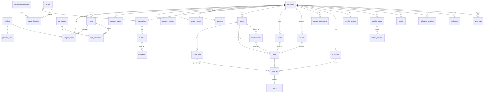

# MALAKY BUS SaaS — PHASE 1: DATABASE DESIGN

Status: DESIGN ONLY. No migrations written yet (migrations start in Phase 2 together with RLS, so tables and policies ship together).

**Revision 2:** owner decisions Q1–Q10 applied (see §9). Table count corrected to 34 (revision 1 wrongly said 33; the original design had 31).

---

## 1. Design conventions (apply to every table)

| Convention | Decision | Reason |
|---|---|---|
| Primary keys | `uuid` default `gen_random_uuid()` | Non-guessable IDs, reduces IDOR surface |
| Tenant column | Every tenant-owned table has `company_id uuid NOT NULL REFERENCES companies(id) ON DELETE RESTRICT` | RLS anchor, no accidental cascade wipes |
| Tenant-consistent FKs | Parents expose `UNIQUE (company_id, id)`. Children reference `(company_id, parent_id)` | DB itself rejects cross-tenant links (e.g. a Company A trip pointing to a Company B bus). Defence in depth beyond RLS |
| Enumerations | `text` + `CHECK (... IN (...))`, not PG `ENUM` | Adding a value is a simple migration; PG enums are painful to alter |
| Money | `numeric(12,2)` + `currency char(3)` (ISO 4217) | No float errors |
| Time | `timestamptz` everywhere. Company timezone stored in `company_settings.timezone` (IANA) | Correct across DST, display converted per tenant |
| Timestamps | `created_at timestamptz NOT NULL DEFAULT now()`; `updated_at` maintained by shared trigger `set_updated_at()` | Auditability |
| Soft delete | `deleted_at timestamptz NULL` only where history matters (see §4). Others use a `status` column | Avoid blanket soft delete complexity |
| Emails | `citext` extension, lower-case compare | Case-insensitive uniqueness |
| Extensions | `pgcrypto` (or built-in `gen_random_uuid`), `citext`, `btree_gist` | `btree_gist` enables overlap exclusion constraints for bus/driver conflicts |
| Actor columns | `created_by uuid REFERENCES profiles(id) ON DELETE SET NULL` where useful | Who did it |

---

## 2. Deviations from the master table list (and why)

| Change | Reason |
|---|---|
| **Dropped `user_roles`** | A user has exactly one role per company, so `company_users.role_id` is enough. Platform roles live in `platform_users.role`. Avoids an extra join in every RLS check. Multi-company is supported because membership is per `(company_id, user_id)` |
| **Added `plan_entitlements` + `entitlement_definitions`** | Satisfies "configurable plan limits, nothing hard-coded". Definitions table prevents typos in limit keys |
| **Added `company_notes`** | Super Admin internal notes must never be readable by company users. A separate table is safer than a column hidden by column-level privileges |
| **`subscriptions` listed twice in master list** | Single table, under Billing |
| **No `usage` table yet** | Usage = live counts against plan limits. Materialised usage deferred to Phase 15 if counts get slow |
| **No `booking_seats` table yet** | Count-only decided (Q1). Add later only if a seat map is wanted |
| **`profiles.email` mirrored from `auth.users`** | Needed for user lists and joins. Synced by trigger. Email is not editable in `profiles` |

Total: **34 tables** = 31 original + `booking_payments`, `trip_templates`, `website_publications` (added in revision 2).

---

## 3. Entity relationship overview

Ownership summary:

| Domain | Owner | Scope |
|---|---|---|
| Platform catalog (`plans`, `permissions`, `entitlement_definitions`, system `roles`) | MALAKY | Global, read-only to tenants |
| Tenant data (everything else) | The company | Isolated by `company_id` |
| Identity (`profiles`) | The user | Global, one row per `auth.users` row |

---

## 4. Table specifications

Legend: PK = primary key, FK = foreign key, UQ = unique, `NN` = NOT NULL.

### 4.1 Identity & authorization

#### `profiles`
Purpose: app-level identity, 1:1 with `auth.users`. Global (not tenant-owned).

| Column | Type | Null | Default / Notes |
|---|---|---|---|
| id | uuid | NN | PK, FK → `auth.users(id)` ON DELETE CASCADE |
| email | citext | NN | UQ. Mirrored from auth by trigger |
| full_name | text | NN | |
| phone | text | | |
| avatar_media_id | uuid | | FK → `media(id)` ON DELETE SET NULL (deferred; added after `media`) |
| locale | text | NN | `'ar'`, CHECK IN (`ar`, `en`) |
| is_active | boolean | NN | `true` (platform-level ban switch) |
| created_at / updated_at | timestamptz | NN | now() |

Indexes: PK, UQ(email). Soft delete: none (deactivate via `is_active`).

#### `platform_users`
Purpose: MALAKY staff. Kept completely separate from company membership.

| Column | Type | Null | Default / Notes |
|---|---|---|---|
| user_id | uuid | NN | PK, FK → `profiles(id)` ON DELETE CASCADE |
| role | text | NN | CHECK IN (`super_admin`, `support`, `billing`) |
| is_active | boolean | NN | `true` |
| created_by | uuid | | FK → profiles |
| created_at / updated_at | timestamptz | NN | |

A user in `platform_users` is **not** automatically a member of any company.

#### `permissions` (global catalog)

| Column | Type | Null | Notes |
|---|---|---|---|
| id | uuid | NN | PK |
| key | text | NN | UQ, e.g. `trips.read`, `trips.write`, `bookings.write`, `billing.read` |
| module | text | NN | e.g. `trips`, `billing` (grouping for UI) |
| description | text | | |
| created_at | timestamptz | NN | |

#### `roles`
Purpose: fixed system roles (decision Q9). Custom per-company roles are NOT in V1.

| Column | Type | Null | Notes |
|---|---|---|---|
| id | uuid | NN | PK |
| key | text | NN | UQ. `owner`, `manager`, `operations`, `booking`, `driver` |
| name | text | NN | |
| description | text | | |
| created_at / updated_at | timestamptz | NN | |

No `company_id` in V1: roles are global and editable only by MALAKY via migration/seed. The permission model stays extensible: `role_permissions` is data, so adding a permission or changing a role's grants needs no code change. Custom roles later = migration adding nullable `roles.company_id` + a unique index, with no change to `company_users` or `role_permissions`.

#### `role_permissions`

| Column | Type | Null | Notes |
|---|---|---|---|
| role_id | uuid | NN | FK → roles ON DELETE CASCADE |
| permission_id | uuid | NN | FK → permissions ON DELETE CASCADE |

PK `(role_id, permission_id)`. Index on `permission_id`.

#### `company_users` (membership)
Purpose: links a user to a company with one role. Foundation for multi-company users.

| Column | Type | Null | Notes |
|---|---|---|---|
| id | uuid | NN | PK |
| company_id | uuid | NN | FK → companies |
| user_id | uuid | NN | FK → profiles ON DELETE CASCADE |
| role_id | uuid | NN | FK → roles ON DELETE RESTRICT |
| status | text | NN | CHECK IN (`active`, `suspended`) default `active` |
| invited_by | uuid | | FK → profiles |
| created_at / updated_at | timestamptz | NN | |

Constraints: UQ `(company_id, user_id)`. UQ `(company_id, id)`. **V1 rule (Q8): `UNIQUE (user_id)`**: one company per user. This is a deliberate, removable constraint. RLS helpers are written for N memberships, so dropping it later is a single migration.
Indexes: `(user_id)` (hot path: "which companies am I in"), `(company_id, role_id)`.
Rules enforced later (trigger): every company keeps at least one active `owner`.

#### `company_invites`

| Column | Type | Null | Notes |
|---|---|---|---|
| id | uuid | NN | PK |
| company_id | uuid | NN | FK |
| email | citext | NN | |
| role_id | uuid | NN | FK → roles |
| token_hash | text | NN | UQ. Only the **hash** is stored, raw token goes in the email |
| status | text | NN | CHECK IN (`pending`, `accepted`, `revoked`, `expired`) |
| expires_at | timestamptz | NN | |
| invited_by | uuid | | FK → profiles |
| accepted_by | uuid | | FK → profiles |
| accepted_at | timestamptz | | |
| created_at | timestamptz | NN | |

Constraints: partial UQ `(company_id, email) WHERE status = 'pending'`. Index `(company_id, status)`.

---

### 4.2 Platform

#### `companies`

| Column | Type | Null | Default / Notes |
|---|---|---|---|
| id | uuid | NN | PK |
| name | text | NN | |
| slug | citext | NN | UQ. Used for default subdomain. CHECK `slug ~ '^[a-z0-9]([a-z0-9-]{1,38})[a-z0-9]$'`. Reserved words (`www`, `admin`, `api`, `app`) blocked via CHECK or trigger |
| status | text | NN | CHECK IN (`trial`, `active`, `suspended`, `cancelled`). Default `trial` |
| legal_name | text | | |
| tax_number | text | | |
| contact_email | citext | | |
| contact_phone | text | | |
| country | char(2) | | ISO 3166-1 |
| suspended_at | timestamptz | | |
| suspension_reason | text | | Platform-visible; see note below |
| created_by | uuid | | FK → profiles (platform user) |
| created_at / updated_at | timestamptz | NN | |
| deleted_at | timestamptz | | Soft delete |

Constraint: UQ `(id)` is the PK; child tables reference `companies(id)` only. Index: `(status)`, partial UQ on slug where `deleted_at IS NULL` is **not** used: slugs are never reused (prevents subdomain takeover).
Note: `suspension_reason` is internal; companies read a safe view/RPC (decided in Phase 2).

#### `company_notes`
Platform-only internal notes.

| Column | Type | Null | Notes |
|---|---|---|---|
| id | uuid | NN | PK |
| company_id | uuid | NN | FK |
| author_id | uuid | | FK → profiles ON DELETE SET NULL |
| body | text | NN | |
| created_at | timestamptz | NN | |

Index `(company_id, created_at DESC)`. RLS: platform users only; **no** company access policy at all.

#### `company_settings` (1:1)

| Column | Type | Null | Default / Notes |
|---|---|---|---|
| company_id | uuid | NN | PK, FK → companies ON DELETE RESTRICT |
| timezone | text | NN | `'Africa/Cairo'` (validated in app against IANA list) |
| currency | char(3) | NN | `'EGP'` |
| default_locale | text | NN | `'ar'`. Must be a member of `supported_locales` |
| supported_locales | text[] | NN | `'{ar,en}'`. Non-empty, subset of `{ar,en}` |
| booking_enabled | boolean | NN | `true` |
| allow_guest_booking | boolean | NN | `true` |
| booking_cutoff_minutes | integer | NN | `60`, CHECK >= 0. Stop sales N min before departure |
| cancellation_window_hours | integer | NN | `24`, CHECK >= 0 |
| max_seats_per_booking | smallint | NN | `4`, CHECK BETWEEN 1 AND 50 |
| trip_buffer_minutes | smallint | NN | `30`, CHECK BETWEEN 0 AND 600. Turnaround time after each trip before the same bus/driver can start another (Q4) |
| created_at / updated_at | timestamptz | NN | |

Typed columns, not jsonb: these are queried in booking logic and need constraints.

#### `domains`

| Column | Type | Null | Notes |
|---|---|---|---|
| id | uuid | NN | PK |
| company_id | uuid | NN | FK |
| hostname | citext | NN | **Globally UQ**. CHECK lower-case, no scheme/path/port |
| kind | text | NN | CHECK IN (`platform_subdomain`, `custom`) |
| is_primary | boolean | NN | `false` |
| verification_status | text | NN | CHECK IN (`pending`, `verified`, `failed`). Platform subdomains are created `verified` |
| verification_token | text | | For DNS TXT check (custom only) |
| verified_at | timestamptz | | |
| created_at / updated_at | timestamptz | NN | |

Constraints: UQ(hostname). Partial UQ `(company_id) WHERE is_primary`. Index `(company_id)`.
Tenant resolution query: `SELECT company_id FROM domains WHERE hostname = $1 AND verification_status = 'verified'` (plus company status check). Hostname UQ index serves it.

#### `plans`

| Column | Type | Null | Notes |
|---|---|---|---|
| id | uuid | NN | PK |
| code | text | NN | UQ: `starter`, `professional`, `enterprise` |
| name | text | NN | |
| description | text | | |
| price_monthly | numeric(12,2) | NN | `0`, CHECK >= 0 |
| price_yearly | numeric(12,2) | | |
| currency | char(3) | NN | |
| trial_days | integer | NN | `14` |
| is_public | boolean | NN | `true` (hide custom/enterprise deals) |
| is_active | boolean | NN | `true` (retire without deleting) |
| sort_order | integer | NN | `0` |
| created_at / updated_at | timestamptz | NN | |

#### `entitlement_definitions`
Catalog of valid limit/feature keys.

| Column | Type | Null | Notes |
|---|---|---|---|
| key | text | NN | PK, e.g. `max_users`, `max_buses`, `max_drivers`, `max_routes`, `max_trips_per_month`, `max_bookings_per_month`, `feature_analytics`, `feature_custom_domain`, `feature_notifications_sms` |
| value_type | text | NN | CHECK IN (`integer`, `boolean`) |
| description | text | | |

#### `plan_entitlements`

| Column | Type | Null | Notes |
|---|---|---|---|
| plan_id | uuid | NN | FK → plans ON DELETE CASCADE |
| key | text | NN | FK → entitlement_definitions(key) |
| int_value | integer | | NULL with value_type integer = **unlimited** |
| bool_value | boolean | | |

PK `(plan_id, key)`. CHECK: exactly one of `int_value`/`bool_value` is set, or neither for unlimited integers (type-vs-definition match enforced by trigger/app). Adding a new limit = one row in definitions + rows per plan. No code change in schema.

#### `subscriptions`

| Column | Type | Null | Notes |
|---|---|---|---|
| id | uuid | NN | PK |
| company_id | uuid | NN | FK |
| plan_id | uuid | NN | FK → plans ON DELETE RESTRICT |
| status | text | NN | CHECK IN (`trialing`, `active`, `past_due`, `cancelled`, `expired`) |
| billing_interval | text | NN | CHECK IN (`monthly`, `yearly`) |
| trial_ends_at | timestamptz | | |
| current_period_start | timestamptz | NN | |
| current_period_end | timestamptz | NN | CHECK > start |
| cancel_at_period_end | boolean | NN | `false` |
| cancelled_at | timestamptz | | |
| provider | text | | `NULL` until a payment provider is chosen |
| provider_customer_id | text | | |
| provider_subscription_id | text | | |
| created_at / updated_at | timestamptz | NN | |

Constraints: partial UQ `(company_id) WHERE status IN ('trialing','active','past_due')` = at most one live subscription per company. Index `(company_id, created_at DESC)`, `(status, current_period_end)` (expiry job). Provider columns are generic so any provider fits later. History kept: old rows are never deleted.

#### `invoices`

| Column | Type | Null | Notes |
|---|---|---|---|
| id | uuid | NN | PK |
| company_id | uuid | NN | FK |
| subscription_id | uuid | | FK → subscriptions ON DELETE SET NULL |
| invoice_number | text | NN | UQ (platform-wide sequence) |
| status | text | NN | CHECK IN (`draft`, `open`, `paid`, `void`, `uncollectible`) |
| currency | char(3) | NN | |
| subtotal | numeric(12,2) | NN | |
| tax | numeric(12,2) | NN | `0` |
| total | numeric(12,2) | NN | CHECK total = subtotal + tax |
| period_start / period_end | timestamptz | | |
| issued_at / due_at / paid_at | timestamptz | | |
| provider_invoice_id | text | | |
| created_at / updated_at | timestamptz | NN | |

Index `(company_id, created_at DESC)`, `(status, due_at)`. Never hard-deleted (accounting).

#### `payments`
Purpose: **platform** billing payments (company pays MALAKY). Customer booking payments are a separate future concern (Q3).

| Column | Type | Null | Notes |
|---|---|---|---|
| id | uuid | NN | PK |
| company_id | uuid | NN | FK |
| invoice_id | uuid | NN | FK → invoices ON DELETE RESTRICT |
| amount | numeric(12,2) | NN | CHECK > 0 |
| currency | char(3) | NN | |
| status | text | NN | CHECK IN (`pending`, `succeeded`, `failed`, `refunded`) |
| method | text | | `card`, `bank_transfer`, `manual`... |
| provider | text | | |
| provider_payment_id | text | | UQ per provider where not null |
| paid_at | timestamptz | | |
| created_at / updated_at | timestamptz | NN | |

#### `audit_logs`
Append-only.

| Column | Type | Null | Notes |
|---|---|---|---|
| id | uuid | NN | PK |
| actor_id | uuid | | FK → profiles ON DELETE SET NULL |
| actor_type | text | NN | CHECK IN (`platform_user`, `company_user`, `customer`, `system`) |
| company_id | uuid | | FK → companies. NULL = platform-level action |
| action | text | NN | e.g. `trip.created`, `booking.cancelled`, `subscription.changed` |
| entity_type | text | NN | |
| entity_id | uuid | | |
| metadata | jsonb | NN | `'{}'`. Changed fields only. **Never** secrets or tokens |
| ip_address | inet | | |
| user_agent | text | | |
| created_at | timestamptz | NN | |

Indexes: `(company_id, created_at DESC)`, `(entity_type, entity_id)`, `(actor_id, created_at DESC)`. No UPDATE/DELETE policies, writes only through a SECURITY DEFINER function or server code. Designed to be range-partitioned by `created_at` later without schema change (high-volume table).

---

### 4.3 Transportation (all tenant-owned)

Every table below has `company_id NN` and `UQ (company_id, id)` so children can use composite FKs.

#### `routes`

| Column | Type | Null | Notes |
|---|---|---|---|
| id | uuid | NN | PK |
| company_id | uuid | NN | FK |
| name | text | NN | |
| code | text | | Short code, UQ per company where not null |
| origin_name | text | NN | Display text (e.g. "Fayoum") |
| destination_name | text | NN | (e.g. "Cairo University") |
| description | text | | |
| is_active | boolean | NN | `true` |
| created_at / updated_at | timestamptz | NN | |
| deleted_at | timestamptz | | Soft delete |

Indexes: `(company_id) WHERE deleted_at IS NULL`; partial UQ `(company_id, code) WHERE code IS NOT NULL AND deleted_at IS NULL`.

#### `route_stops`

| Column | Type | Null | Notes |
|---|---|---|---|
| id | uuid | NN | PK |
| company_id | uuid | NN | |
| route_id | uuid | NN | Composite FK `(company_id, route_id)` → routes, ON DELETE CASCADE |
| name | text | NN | |
| address | text | | |
| latitude / longitude | numeric(9,6) | | CHECK ranges, both-or-neither |
| stop_order | smallint | NN | CHECK >= 1 |
| stop_type | text | NN | CHECK IN (`pickup`, `dropoff`, `both`) default `both` |
| offset_minutes | smallint | NN | `0`. Minutes after trip departure. Arrival time at each stop is derived |
| is_active | boolean | NN | `true` |
| created_at / updated_at | timestamptz | NN | |

Constraints: UQ `(route_id, stop_order)` DEFERRABLE INITIALLY DEFERRED (allows reordering in one transaction). UQ `(company_id, id)`.

#### `buses`

| Column | Type | Null | Notes |
|---|---|---|---|
| id | uuid | NN | PK |
| company_id | uuid | NN | |
| plate_number | text | NN | UQ `(company_id, plate_number)` |
| name | text | | Internal nickname |
| capacity | smallint | NN | CHECK BETWEEN 1 AND 100 |
| make / model | text | | |
| year | smallint | | |
| status | text | NN | CHECK IN (`active`, `maintenance`, `inactive`) default `active` |
| notes | text | | |
| created_at / updated_at | timestamptz | NN | |

Deactivate via `status` (no soft delete). Bus documents live in `media` (kind `bus_document`, private).

#### `drivers`

| Column | Type | Null | Notes |
|---|---|---|---|
| id | uuid | NN | PK |
| company_id | uuid | NN | |
| user_id | uuid | | FK → profiles. Set only if driver has a login. Partial UQ `(company_id, user_id) WHERE user_id IS NOT NULL` |
| full_name | text | NN | |
| phone | text | NN | |
| license_number | text | | |
| license_expiry | date | | |
| photo_media_id | uuid | | Composite FK `(company_id, photo_media_id)` → media |
| status | text | NN | CHECK IN (`active`, `inactive`) default `active` |
| notes | text | | |
| created_at / updated_at | timestamptz | NN | |

A driver with login also has a `company_users` row with role `driver`. The link between the two is `drivers.user_id`, which is how RLS finds "my assigned trips".

#### `trips`

| Column | Type | Null | Notes |
|---|---|---|---|
| id | uuid | NN | PK |
| company_id | uuid | NN | |
| route_id | uuid | NN | Composite FK → routes, ON DELETE RESTRICT |
| bus_id | uuid | | Composite FK → buses, RESTRICT. NULL allowed only while `draft` |
| driver_id | uuid | | Composite FK → drivers, RESTRICT. NULL allowed only while `draft` |
| departure_at | timestamptz | NN | |
| arrival_at | timestamptz | NN | CHECK `arrival_at > departure_at` |
| buffer_minutes | smallint | NN | Snapshot of `company_settings.trip_buffer_minutes` at write time (Q4). CHECK >= 0 |
| blocked_until | timestamptz | NN | `arrival_at + buffer_minutes`, maintained by trigger. CHECK `blocked_until >= arrival_at`. Used by the conflict constraints |
| template_id | uuid | | Composite FK → trip_templates, ON DELETE SET NULL. Set when generated from a recurring template |
| price | numeric(12,2) | NN | CHECK >= 0 (company currency) |
| capacity | smallint | NN | Seats offered. Snapshot of bus capacity at assignment, may be lower. CHECK > 0 |
| seats_booked | smallint | NN | `0`. CHECK `seats_booked BETWEEN 0 AND capacity` |
| status | text | NN | CHECK IN (`draft`, `scheduled`, `boarding`, `in_progress`, `completed`, `cancelled`) default `draft` |
| notes | text | | |
| created_by | uuid | | FK → profiles |
| created_at / updated_at | timestamptz | NN | |

Derived: `available_seats = capacity - seats_booked` (computed in a view/query, **not stored**, so it cannot drift).

Hard guarantees in the database:

| Rule | Mechanism |
|---|---|
| No overbooking | `CHECK (seats_booked <= capacity)` + counter updated atomically inside the booking function (row lock) |
| Bus cannot be in two overlapping trips **including buffer** | `EXCLUDE USING gist (bus_id WITH =, tstzrange(departure_at, blocked_until) WITH &&) WHERE (bus_id IS NOT NULL AND status NOT IN ('draft','cancelled'))` |
| Driver cannot be in two overlapping trips **including buffer** | Same exclusion on `driver_id` |
| No duplicate generated trips | Partial UQ `(template_id, departure_at) WHERE template_id IS NOT NULL` |
| Inactive bus/driver not assignable | Trigger on insert/update (needs lookup, can't be a CHECK) |
| `scheduled`+ trips must have bus and driver | `CHECK (status = 'draft' OR (bus_id IS NOT NULL AND driver_id IS NOT NULL))` |
| Capacity <= bus capacity | Trigger |

Indexes:
- `(company_id, departure_at)` for dashboards
- `(company_id, route_id, departure_at) WHERE status = 'scheduled'` for public trip search
- `(bus_id)`, `(driver_id)` (FK + driver "my trips" queries), `(template_id)`

Why `blocked_until` is a stored column: `timestamptz + interval` is only STABLE in Postgres, so it cannot be used in an exclusion-constraint expression or generated column. A trigger-maintained column is immutable data and works. Changing the company buffer setting affects only trips written afterwards (intentional: existing schedules do not silently shift).

Trips are cancelled by status, never deleted once they have bookings (RESTRICT FK from bookings). Drafts with no bookings may be hard-deleted.

#### `trip_templates` (recurring trips, Q6)

| Column | Type | Null | Notes |
|---|---|---|---|
| id | uuid | NN | PK |
| company_id | uuid | NN | |
| name | text | NN | e.g. "Fayoum → Cairo Univ. 07:30" |
| route_id | uuid | NN | Composite FK → routes, RESTRICT |
| bus_id | uuid | | Composite FK → buses. Default assignment, optional |
| driver_id | uuid | | Composite FK → drivers. Default assignment, optional |
| departure_time | time | NN | Local time in the company timezone |
| duration_minutes | smallint | NN | CHECK > 0. `arrival_at = departure_at + duration` |
| days_of_week | smallint[] | NN | ISO 1–7 (Mon–Sun). Non-empty, values 1..7 |
| start_date | date | NN | |
| end_date | date | | NULL = open-ended. CHECK >= start_date |
| price | numeric(12,2) | NN | CHECK >= 0 |
| capacity | smallint | NN | CHECK > 0 |
| is_active | boolean | NN | `true` |
| generated_through | date | | Last date already generated (idempotency marker) |
| created_at / updated_at | timestamptz | NN | |

Generation: a scheduled job (Edge Function/cron, built in Phase 5) creates concrete `trips` rows a rolling window ahead (default 30 days; Q12). It is idempotent (`ON CONFLICT DO NOTHING` on the template/departure unique index). Local time is converted using the company timezone **at generation time**, so DST is handled. If a generated trip would violate a bus/driver conflict, it is inserted as `draft` with bus/driver NULL and flagged for staff. Generated trips are normal trips: editing one never changes the template or siblings. Template edits affect only not-yet-generated dates (Q13).

---

### 4.4 Customers & bookings

#### `customers`

| Column | Type | Null | Notes |
|---|---|---|---|
| id | uuid | NN | PK |
| company_id | uuid | NN | |
| full_name | text | NN | |
| phone | text | NN | Normalised E.164 in app layer |
| email | citext | | |
| university | text | | |
| student_id | text | | |
| notes | text | | Staff-only |
| created_at / updated_at | timestamptz | NN | |
| deleted_at | timestamptz | | Soft delete / anonymisation marker (personal data) |

Constraints: UQ `(company_id, id)`. Identity key (Q2 decided: guest booking + internal customer profile): partial UQ `(company_id, phone) WHERE deleted_at IS NULL`. Public booking upserts the customer by `(company_id, phone)`. **No customer login in V1**, so no `user_id` column. If accounts are added later, a nullable `customers.user_id` is a simple migration.
Customers are **per company**. The same human booking with two companies = two rows. This is intentional isolation.

#### `bookings`

| Column | Type | Null | Notes |
|---|---|---|---|
| id | uuid | NN | PK |
| company_id | uuid | NN | |
| reference | text | NN | Human-friendly code (e.g. `MB-7K3Q9X`). UQ `(company_id, reference)` |
| trip_id | uuid | NN | Composite FK → trips, RESTRICT |
| customer_id | uuid | NN | Composite FK → customers, RESTRICT |
| pickup_stop_id | uuid | | Composite FK → route_stops |
| dropoff_stop_id | uuid | | Composite FK → route_stops |
| seats_count | smallint | NN | CHECK > 0 |
| unit_price | numeric(12,2) | NN | **Snapshot** of trip price at booking time |
| total_amount | numeric(12,2) | NN | CHECK `total_amount = unit_price * seats_count` |
| currency | char(3) | NN | Snapshot |
| status | text | NN | CHECK IN (`pending`, `confirmed`, `cancelled`, `completed`, `no_show`) |
| payment_status | text | NN | CHECK IN (`unpaid`, `partial`, `paid`, `refunded`) default `unpaid`. Online payment later (Q3) |
| source | text | NN | CHECK IN (`web`, `staff`) |
| idempotency_key | text | | Public form double-submit protection. Partial UQ `(company_id, idempotency_key)` |
| notes | text | | |
| created_by | uuid | | FK → profiles (NULL for public web bookings) |
| cancelled_at | timestamptz | | |
| cancelled_by | uuid | | FK → profiles |
| cancellation_reason | text | | |
| created_at / updated_at | timestamptz | NN | |

Constraints:
- CHECK `status <> 'cancelled' OR cancelled_at IS NOT NULL`
- Pickup/drop-off stops must belong to the trip's route (trigger, a CHECK cannot cross tables)

Indexes: `(company_id, trip_id)`, `(company_id, customer_id)`, `(company_id, created_at DESC)`, `(company_id, status)`.

Seat counter rule: only `pending` and `confirmed` bookings count toward `trips.seats_booked`. Cancelling releases seats in the same transaction. All writes go through one database function (Phase 5/8), never raw client inserts.
Bookings are never deleted. Cancel by status.

#### `booking_payments` (schema prepared for future online payment, Q3)

Created in the Phase 2 migration but **unused by V1 code**: V1 only toggles `bookings.payment_status` manually (cash).

| Column | Type | Null | Notes |
|---|---|---|---|
| id | uuid | NN | PK |
| company_id | uuid | NN | |
| booking_id | uuid | NN | Composite FK → bookings, RESTRICT |
| amount | numeric(12,2) | NN | CHECK > 0 |
| currency | char(3) | NN | |
| method | text | NN | CHECK IN (`cash`, `card`, `wallet`, `bank_transfer`, `other`) |
| status | text | NN | CHECK IN (`pending`, `succeeded`, `failed`, `refunded`) |
| provider | text | | NULL for cash |
| provider_payment_id | text | | Partial UQ `(provider, provider_payment_id)` where not null |
| recorded_by | uuid | | FK → profiles |
| paid_at | timestamptz | | |
| created_at / updated_at | timestamptz | NN | |

Index `(company_id, booking_id)`. Separate from platform `payments` (company → MALAKY). Per-company provider credentials are NOT stored here; they will live in a dedicated secrets design (Vault/encrypted), decided when payments are built. `bookings.payment_status` becomes derived from this table at that point.

---

### 4.5 Website

#### `website_settings` (1:1)

| Column | Type | Null | Notes |
|---|---|---|---|
| company_id | uuid | NN | PK, FK |
| is_published | boolean | NN | `false` |
| site_title | jsonb | | Localized map `{"ar": "...", "en": "..."}` |
| meta_description | jsonb | | Localized map |
| logo_media_id | uuid | | Composite FK → media |
| favicon_media_id | uuid | | Composite FK → media |
| primary_color | text | NN | CHECK `~ '^#[0-9a-fA-F]{6}$'` |
| secondary_color | text | NN | same CHECK |
| font_heading / font_body | text | NN | From an allow-list in app, not free text in CSS |
| contact_email / contact_phone / contact_whatsapp | text | | |
| contact_address | jsonb | | Localized map |
| social_links | jsonb | NN | `'{}'`. Keys limited to a known set, URLs validated (https only) in Zod. Not queried, so jsonb fits |
| footer_text | jsonb | | Localized map |
| created_at / updated_at | timestamptz | NN | |

Colours and fonts are validated values, so company-supplied data can never inject CSS/JS.

#### `website_pages`

| Column | Type | Null | Notes |
|---|---|---|---|
| id | uuid | NN | PK |
| company_id | uuid | NN | |
| slug | text | NN | UQ `(company_id, slug)`. `''` or `home` for homepage |
| title | jsonb | NN | Localized map |
| is_home | boolean | NN | `false`. Partial UQ `(company_id) WHERE is_home` |
| is_published | boolean | NN | `true` |
| seo_title / seo_description | jsonb | | Localized maps |
| created_at / updated_at | timestamptz | NN | |

#### `website_sections`

| Column | Type | Null | Notes |
|---|---|---|---|
| id | uuid | NN | PK |
| company_id | uuid | NN | |
| page_id | uuid | NN | Composite FK → website_pages, ON DELETE CASCADE |
| type | text | NN | CHECK IN (`hero`, `about`, `features`, `routes`, `trips`, `faq`, `contact`, `footer`, `rich_text`, `image`) |
| sort_order | integer | NN | |
| is_enabled | boolean | NN | `true` |
| content | jsonb | NN | `'{}'`. Shape validated per `type` with Zod on every write |
| created_at / updated_at | timestamptz | NN | |

Index `(page_id, sort_order)`. This page/section/jsonb shape is what allows a drag-and-drop builder later (reorder = update `sort_order`; new block = new `type`). Dynamic sections (`routes`, `trips`) store only display options and read live data from transport tables. Media references inside `content` use `media_id`, never raw URLs. Text fields inside `content` are localized maps (`{"ar": ..., "en": ...}`); a missing locale falls back to the company default locale. **`website_settings`, `website_pages` and `website_sections` are the DRAFT working copy** that dashboard users edit. Visitors never read them (see `website_publications`).

#### `website_publications` (draft / preview / publish, Q5)

| Column | Type | Null | Notes |
|---|---|---|---|
| id | uuid | NN | PK |
| company_id | uuid | NN | |
| version | integer | NN | UQ `(company_id, version)`, increments per publish |
| snapshot | jsonb | NN | Immutable resolved copy: settings, pages, sections, media references, supported locales. Validated by Zod before insert |
| is_current | boolean | NN | Partial UQ `(company_id) WHERE is_current` |
| published_by | uuid | | FK → profiles |
| published_at | timestamptz | NN | now() |
| note | text | | |

How it works:
- Dashboard edits the draft tables freely.
- **Preview**: server renders from the draft tables for an authenticated company user with `website.write`. Not reachable anonymously.
- **Publish**: one transaction builds the snapshot, inserts a new version, flips `is_current`.
- **Public site** reads only the current publication (one indexed row, easy to cache). Anonymous RLS exposes this row only for active companies on verified domains. Unpublished drafts can never leak.
- **Rollback**: set an older version `is_current`. Keep the last N versions (default 20) via cleanup.

#### `media`

| Column | Type | Null | Notes |
|---|---|---|---|
| id | uuid | NN | PK |
| company_id | uuid | NN | |
| kind | text | NN | CHECK IN (`logo`, `favicon`, `website_image`, `driver_photo`, `bus_document`, `avatar`, `other`) |
| bucket | text | NN | `company-public` or `company-private` |
| storage_path | text | NN | **Must** start with `{company_id}/`. CHECK enforces it. UQ `(bucket, storage_path)` |
| original_filename | text | NN | Display only, never used as the storage name |
| mime_type | text | NN | Allow-list CHECK |
| size_bytes | bigint | NN | CHECK `> 0 AND <= 10485760` |
| width / height | integer | | Images only |
| alt_text | text | | |
| uploaded_by | uuid | | FK → profiles |
| created_at | timestamptz | NN | |
| deleted_at | timestamptz | | Soft delete, then a cleanup job removes the object |

Index `(company_id, kind)`. Storage policies (Phase 13) compare the first path segment with the user's company, and `media.company_id` is the authoritative owner.

---

### 4.6 Communication

#### `notification_templates`

| Column | Type | Null | Notes |
|---|---|---|---|
| id | uuid | NN | PK |
| company_id | uuid | | NULL = platform default. Company row overrides it |
| key | text | NN | e.g. `booking_confirmed`, `trip_cancelled` |
| channel | text | NN | CHECK IN (`email`, `in_app`, `sms`, `whatsapp`) |
| locale | text | NN | `'en'` |
| subject | text | | Email only |
| body | text | NN | Placeholders such as `{{customer_name}}`, rendered with an allow-listed variable set |
| is_active | boolean | NN | `true` |
| created_at / updated_at | timestamptz | NN | |

UQ index `(COALESCE(company_id, '00000000-0000-0000-0000-000000000000'), key, channel, locale)`.

#### `notifications`
One row per delivery attempt target (acts as in-app inbox and delivery log).

| Column | Type | Null | Notes |
|---|---|---|---|
| id | uuid | NN | PK |
| company_id | uuid | | NULL for platform notices |
| recipient_user_id | uuid | | FK → profiles |
| recipient_customer_id | uuid | | Composite FK → customers |
| recipient_address | text | | Email/phone snapshot used for external channels |
| channel | text | NN | CHECK as above |
| template_key | text | | |
| subject | text | | Rendered |
| body | text | NN | Rendered |
| related_entity_type / related_entity_id | text / uuid | | e.g. `booking` |
| status | text | NN | CHECK IN (`pending`, `sent`, `delivered`, `failed`, `read`) |
| attempts | smallint | NN | `0` |
| error | text | | |
| provider_message_id | text | | |
| scheduled_at / sent_at / read_at | timestamptz | | |
| created_at | timestamptz | NN | |

CHECK: at least one recipient column set. Indexes: `(recipient_user_id, status, created_at DESC)` (inbox), `(status, scheduled_at) WHERE status = 'pending'` (worker queue), `(company_id, created_at DESC)`.
WhatsApp/SMS later = new `channel` values handled by new workers. No schema change.

---

## 5. Relationship rules and delete behaviour

| Parent → Child | On delete | Why |
|---|---|---|
| auth.users → profiles | CASCADE | Profile has no meaning without auth |
| profiles → company_users | CASCADE | Membership dies with user |
| companies → any tenant table | **RESTRICT** | Companies are soft-deleted (`status`, `deleted_at`). Hard purge only via an audited platform function that deletes in dependency order |
| routes → route_stops | CASCADE | Stops belong to the route (route itself is only soft-deleted when trips exist) |
| routes / buses / drivers → trips | RESTRICT | History must stay valid |
| trips → bookings | RESTRICT | Money/records. Cancel instead |
| customers → bookings | RESTRICT | Same. Anonymise customer data instead of deleting |
| website_pages → website_sections | CASCADE | |
| media → referencing columns | SET NULL (or RESTRICT for composite FKs: use trigger to null) | Removing an image must not break a page |
| plans → subscriptions | RESTRICT | Retire plans via `is_active` |
| invoices → payments | RESTRICT | Accounting |

Soft delete map:

| Table | Strategy |
|---|---|
| companies, routes, customers, media | `deleted_at` |
| buses, drivers, users (membership), plans | `status` / `is_active` |
| trips, bookings, invoices, subscriptions | Status machine, never deleted |
| audit_logs | Append-only |
| website pages/sections, notification templates | Hard delete (config, not history) |

### Behaviour when a tenant is suspended
- `companies.status = 'suspended'` is the single switch.
- Phase 2 RLS helper `is_company_active(company_id)` is used in write policies, and the public website/booking RPCs reject suspended or cancelled companies.
- Data stays intact. Staff of a suspended company are **fully locked out** (Q7 decided): every tenant RLS policy requires `is_company_active(company_id)`, so even reads return nothing. A SECURITY DEFINER function `my_company_status()` returns only the status so the app can show a "suspended, contact support" screen. Public website and booking RPCs also reject. Only platform users can access the data.

---

## 6. Index summary (beyond PK/UQ above)

| Query pattern | Index |
|---|---|
| "Which companies does this user belong to" (every RLS check) | `company_users(user_id)` |
| Tenant resolution by host | `domains(hostname)` UQ |
| Public trip search | `trips(company_id, route_id, departure_at) WHERE status='scheduled'` |
| Dashboard trips by date | `trips(company_id, departure_at)` |
| Driver "my trips" | `trips(driver_id, departure_at)` |
| Bookings per trip/customer | `bookings(company_id, trip_id)`, `(company_id, customer_id)` |
| Subscription expiry job | `subscriptions(status, current_period_end)` |
| Audit browsing | `audit_logs(company_id, created_at DESC)` |
| Notification worker | `notifications(status, scheduled_at) WHERE status='pending'` |

Every FK column gets an index (Postgres does not create them automatically). Dashboard lists use keyset pagination on `(created_at, id)`.

---

## 7. How this design supports the master rules

| Requirement | Where |
|---|---|
| Tenant isolation never from client `company_id` | `company_id` resolved from `company_users` via `auth.uid()` in RLS (Phase 2). Composite FKs make cross-tenant references impossible even for a buggy policy |
| Plan limits not hard-coded | `plan_entitlements` + `entitlement_definitions` |
| Payment provider later | `provider*` columns generic, nullable |
| Multi-company users later | Membership table keyed by `(company_id, user_id)` |
| Page builder later | `website_pages` → `website_sections` with typed jsonb |
| Overbooking/conflicts impossible | CHECK + exclusion constraints + atomic booking function |
| Auditability | `audit_logs`, `created_by/cancelled_by`, price snapshots |

---

## 8. Risks

| # | Risk | Impact | Mitigation |
|---|---|---|---|
| R1 | `blocked_until` maintained by trigger | If trigger bypassed, conflict check wrong | Revoke direct writes to the column, SQL test that overlap incl. buffer is rejected |
| R2 | `trips.seats_booked` counter can drift if anything bypasses the booking function | Overbooking or phantom full trips | Only the function writes it. Revoke direct UPDATE on that column. Reconciliation test + SQL consistency check |
| R3 | Composite FKs make schema more verbose | Slightly harder migrations | Worth it for isolation. Documented pattern |
| R4 | Phone as customer identity: shared phone merges two people, typo creates duplicate | Wrong/duplicate customer records | Normalise to E.164, staff merge tool later, never overwrite name silently on upsert |
| R5 | `audit_logs` grows fast | Slow queries | Indexes now, monthly partitioning later |
| R6 | jsonb content (sections, localized maps, snapshots) can become inconsistent | Broken pages | Zod per type on every write, locale fallback, version field inside `content` |
| R7 | Trigger-based rules (stop belongs to route, bus/driver active, capacity <= bus) are hidden logic | Harder debugging | Each trigger documented + SQL tests in Phase 2/17 |
| R8 | Suspension reason / internal notes leaking to tenants | Information exposure | Separate `company_notes` table, restricted view/function for status |
| R9 | Recurring generation needs a scheduler (pg_cron or Vercel cron → Edge Function) | Missing trips if job fails | Idempotent job, `generated_through` marker, failure alert, "generate now" button |
| R10 | Full lockout on suspension: owner cannot even export data | Support burden, unhappy customers if suspended by mistake | Platform support procedure, audit log entry, require reason when suspending |
| R11 | `UNIQUE (user_id)` V1 rule | Migration needed for multi-company | RLS helpers already written for N memberships; single migration drops constraint |
| R12 | Publication snapshots reference media | Deleted image breaks old version | Soft-delete media, keep referenced media until no snapshot uses it |
| R13 | Arabic/RTL from day one | Bidi text bugs, search/sort quirks, phone/number formats | `dir` per locale, Arabic-aware collation/search later, tests with mixed AR/EN content |

---

## 9. Decisions applied (Q1–Q10) and schema impact

| # | Decision | Schema impact |
|---|---|---|
| Q1 | Count only | `bookings.seats_count`, no `booking_seats` |
| Q2 | Guest booking + internal customer profile | Removed `customers.user_id`. Upsert by `(company_id, phone)` |
| Q3 | No online payment V1, schema ready | Added `booking_payments` (unused in V1), provider columns stay generic |
| Q4 | 30 min buffer, configurable | `company_settings.trip_buffer_minutes`, `trips.buffer_minutes`, `trips.blocked_until`, exclusion uses `blocked_until` |
| Q5 | Draft + preview | Existing tables = draft, new `website_publications` = immutable published snapshots |
| Q6 | Recurring trips in V1 | Added `trip_templates`, `trips.template_id`, idempotent generation |
| Q7 | Suspended = full lockout | Every tenant policy requires active company, `my_company_status()` function |
| Q8 | One company per user in V1 | `UNIQUE (user_id)` on `company_users` (removable) |
| Q9 | Fixed roles, extensible permissions | Removed `roles.company_id`, `is_system`. `role_permissions` stays data-driven |
| Q10 | Arabic + English from start | `supported_locales`, `default_locale='ar'`, localized jsonb maps for website text, locale-keyed notification templates |

## 9b. New open questions (revision 2)

| # | Question | Recommendation |
|---|---|---|
| Q11 | Operational names entered by companies (routes, stops, buses): single language as typed, or AR+EN fields? | Single language as typed. Forcing bilingual entry for every stop is heavy. Only website/marketing content and system UI are bilingual |
| Q12 | Recurring trips: how far ahead to generate, and what if a bus/driver conflict occurs? | Rolling 30 days, daily job. Conflicting dates become unassigned `draft` trips flagged for staff |
| Q13 | Editing a template: affect only future ungenerated dates, or also already-generated trips? | Future ungenerated only. Existing trips are edited individually |

---

## 10. Phase 1 deliverable status

- Schema designed: **34 tables**, conventions, constraints, indexes, delete rules, tenant-consistency strategy. Q1–Q10 applied
- No SQL written yet by design (Phase 2 creates migrations with RLS)
- Not tested (design phase). Constraint tests are planned for Phase 2/17
- Correction: revision 1 stated 33 tables, the real count was 31. Now 34
- **Ready for Phase 2: YES**, once you approve and confirm or change recommendations Q11–Q13

STOP. Awaiting approval.
